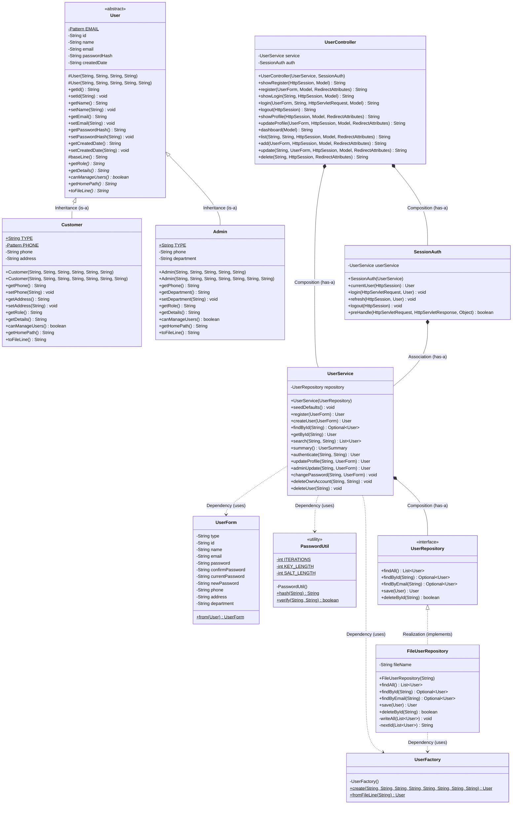
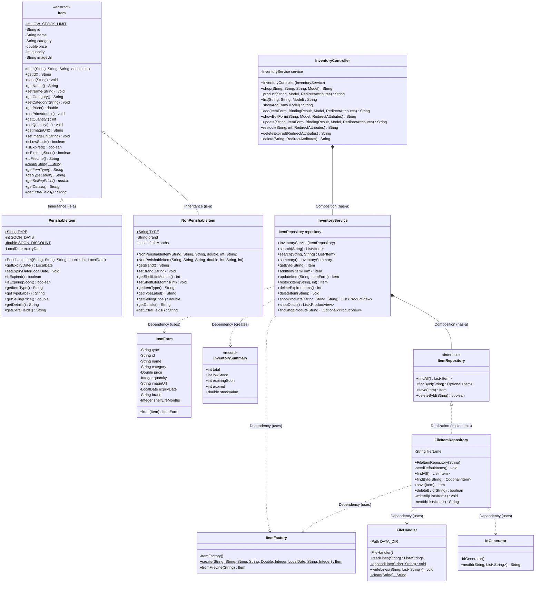
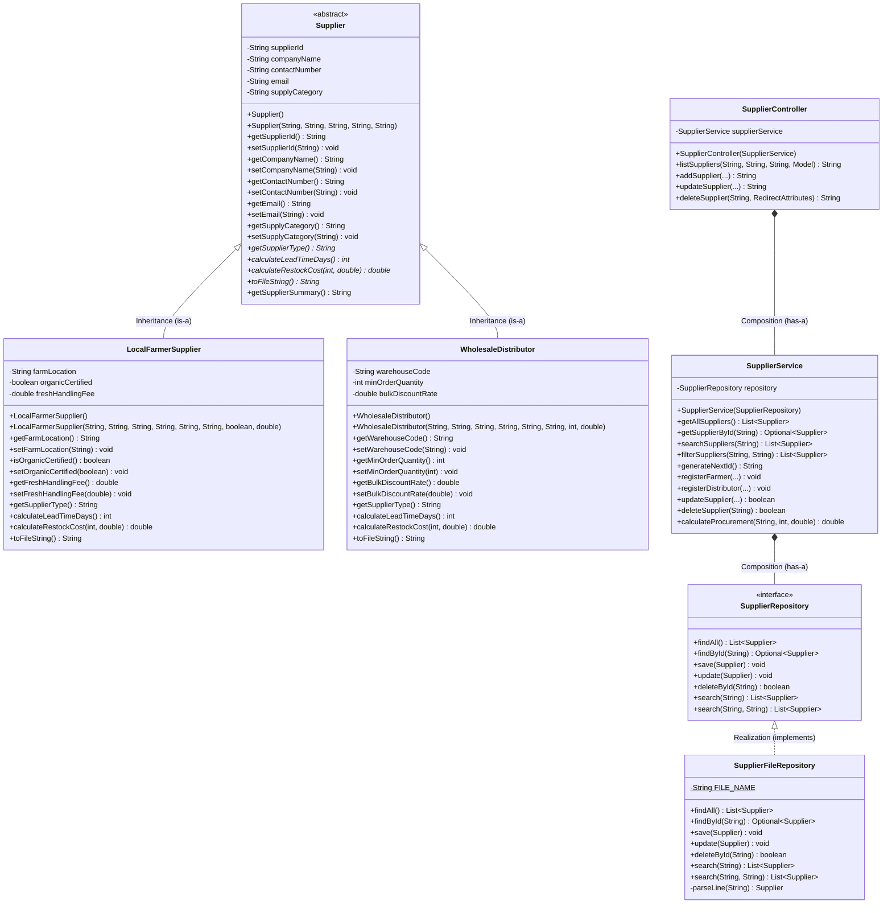
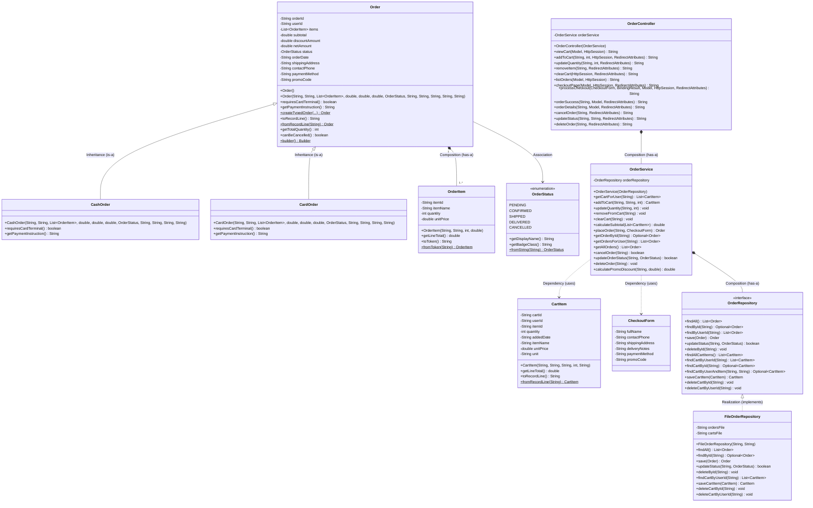
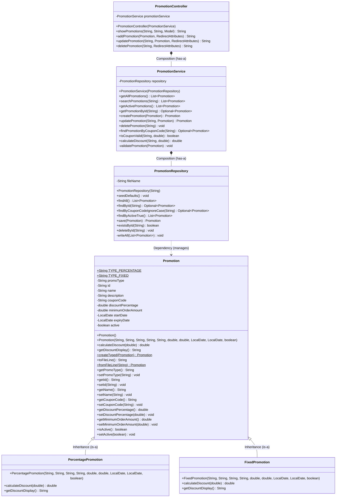
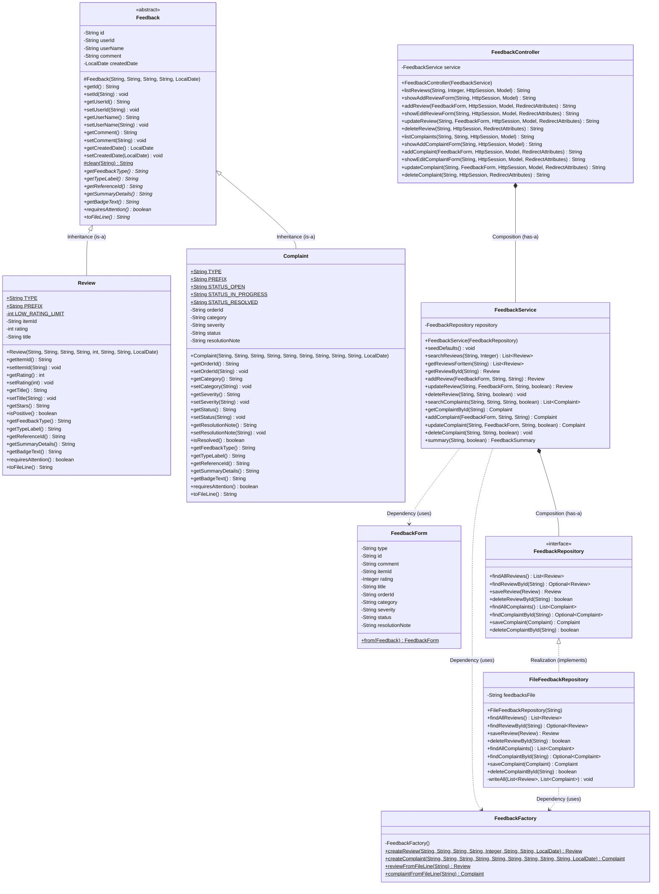

# Complete Project UML Class Diagrams (Full System + All 6 Member Zoomed-In Diagrams)

> **Print Instructions:** Open [printable-class-diagram.html](printable-class-diagram.html) in Chrome or Edge and click **"🖨️ Print / Save as PDF"** (Landscape mode). Each diagram is formatted onto its own clean printable page!

---

## 0. Complete 6-Module System Class Diagram (Whole Group Project Overview)
*(Show this first when the panel asks for the **Complete Class Diagram of the Project**)*

```mermaid
classDiagram
    direction TB

    %% ==================== COMMON MODULE ====================
    class FileHandler {
        <<utility>>
        -Path DATA_DIR$
        +readLines(String)$ List~String~
        +appendLine(String, String)$ void
        +writeLines(String, List~String~)$ void
        +clean(String)$ String
    }
    class IdGenerator {
        <<utility>>
        +nextId(String, List~String~)$ String
    }
    class DataFileException {
        +DataFileException(String, Throwable)
    }
    class GlobalExceptionHandler {
        +handleDataFile(DataFileException, Model) String
        +handleAny(Exception, Model, HttpServletResponse) String
    }

    %% ==================== MODULE 1: USER ====================
    class User {
        <<abstract>>
        -String id
        -String name
        -String email
        -String passwordHash
        -String createdDate
        +getRole()* String
        +getDetails()* String
        +canManageUsers()* boolean
        +getHomePath()* String
        +toFileLine()* String
    }
    class Customer {
        -String phone
        -String address
        +getRole() String
        +getDetails() String
        +canManageUsers() boolean
        +toFileLine() String
    }
    class Admin {
        -String department
        +getRole() String
        +getDetails() String
        +canManageUsers() boolean
        +toFileLine() String
    }
    class UserRepository {
        <<interface>>
        +findAll() List~User~
        +findById(String) Optional~User~
        +findByEmail(String) Optional~User~
        +save(User) User
        +deleteById(String) boolean
    }
    class FileUserRepository {
        -String fileName
        +findAll() List~User~
        +save(User) User
    }
    class UserService {
        -UserRepository repository
        +register(UserForm) User
        +authenticate(String, String) User
        +search(String, String) List~User~
        +deleteUser(String) void
    }
    class UserController {
        -UserService service
        -SessionAuth auth
        +login(...) String
        +register(...) String
        +dashboard(Model) String
        +list(...) String
    }

    %% ==================== MODULE 2: INVENTORY ====================
    class Item {
        <<abstract>>
        -String id
        -String name
        -String category
        -double price
        -int quantity
        -String imageUrl
        +isLowStock() boolean
        +isExpired() boolean
        +isExpiringSoon() boolean
        +toFileLine() String
        +getItemType()* String
        +getSellingPrice()* double
        +getDetails()* String
        #getExtraFields()* String
    }
    class PerishableItem {
        -LocalDate expiryDate
        +isExpired() boolean
        +isExpiringSoon() boolean
        +getSellingPrice() double
        +getDetails() String
    }
    class NonPerishableItem {
        -String brand
        -int shelfLifeMonths
        +getSellingPrice() double
        +getDetails() String
    }
    class ItemRepository {
        <<interface>>
        +findAll() List~Item~
        +findById(String) Optional~Item~
        +save(Item) Item
        +deleteById(String) boolean
    }
    class FileItemRepository {
        -String fileName
        +findAll() List~Item~
        +save(Item) Item
        +deleteById(String) boolean
    }
    class InventoryService {
        -ItemRepository repository
        +search(String, String) List~Item~
        +summary() InventorySummary
        +addItem(ItemForm) Item
        +updateItem(String, ItemForm) Item
        +restockItem(String, int) Item
        +deleteExpiredItems() int
    }
    class InventoryController {
        -InventoryService service
        +shop(...) String
        +list(...) String
        +add(...) String
        +update(...) String
        +restock(...) String
    }

    %% ==================== MODULE 3: SUPPLIER ====================
    class Supplier {
        <<abstract>>
        -String supplierId
        -String companyName
        -String contactNumber
        -String email
        -String supplyCategory
        +getSupplierType()* String
        +calculateLeadTimeDays()* int
        +calculateRestockCost(int, double)* double
        +toFileString()* String
    }
    class LocalFarmerSupplier {
        -String farmLocation
        -boolean organicCertified
        -double freshHandlingFee
        +calculateLeadTimeDays() int
        +calculateRestockCost(int, double) double
    }
    class WholesaleDistributor {
        -String warehouseCode
        -int minOrderQuantity
        -double bulkDiscountRate
        +calculateLeadTimeDays() int
        +calculateRestockCost(int, double) double
    }
    class SupplierRepository {
        <<interface>>
        +findAll() List~Supplier~
        +findById(String) Optional~Supplier~
        +save(Supplier) void
        +deleteById(String) boolean
    }
    class SupplierFileRepository {
        +findAll() List~Supplier~
        +save(Supplier) void
    }
    class SupplierService {
        -SupplierRepository repository
        +getAllSuppliers() List~Supplier~
        +registerFarmer(...) void
        +registerDistributor(...) void
        +calculateProcurement(...) double
    }
    class SupplierController {
        -SupplierService supplierService
        +listSuppliers(...) String
        +addSupplier(...) String
    }

    %% ==================== MODULE 4: ORDER & CART ====================
    class Order {
        -String orderId
        -String userId
        -List~OrderItem~ items
        -double subtotal
        -double discountAmount
        -double netAmount
        -OrderStatus status
        +requiresCardTerminal() boolean
        +getPaymentInstruction() String
        +toRecordLine() String
    }
    class CashOrder {
        +requiresCardTerminal() boolean
        +getPaymentInstruction() String
    }
    class CardOrder {
        +requiresCardTerminal() boolean
        +getPaymentInstruction() String
    }
    class OrderItem {
        -String itemId
        -String itemName
        -int quantity
        -double unitPrice
        +getLineTotal() double
    }
    class CartItem {
        -String cartId
        -String userId
        -String itemId
        -int quantity
        +getLineTotal() double
    }
    class OrderRepository {
        <<interface>>
        +findAll() List~Order~
        +save(Order) Order
        +findCartByUserId(String) List~CartItem~
        +saveCartItem(CartItem) CartItem
    }
    class FileOrderRepository {
        +findAll() List~Order~
        +save(Order) Order
    }
    class OrderService {
        -OrderRepository orderRepository
        +getCartForUser(String) List~CartItem~
        +addToCart(String, String, int) CartItem
        +placeOrder(String, CheckoutForm) Order
        +cancelOrder(String) boolean
    }
    class OrderController {
        -OrderService orderService
        +viewCart(...) String
        +processCheckout(...) String
        +listOrders(...) String
    }

    %% ==================== MODULE 5: PROMOTION ====================
    class Promotion {
        -String promoType
        -String id
        -String name
        -String couponCode
        -double discountPercentage
        -double minimumOrderAmount
        +calculateDiscount(double) double
        +getDiscountDisplay() String
    }
    class PercentagePromotion {
        +calculateDiscount(double) double
        +getDiscountDisplay() String
    }
    class FixedPromotion {
        +calculateDiscount(double) double
        +getDiscountDisplay() String
    }
    class PromotionRepository {
        -String fileName
        +findAll() List~Promotion~
        +save(Promotion) Promotion
        +deleteById(String) void
    }
    class PromotionService {
        -PromotionRepository repository
        +getAllPromotions() List~Promotion~
        +createPromotion(Promotion) Promotion
        +calculateDiscount(String, double) double
    }
    class PromotionController {
        -PromotionService promotionService
        +showPromotions(...) String
        +addPromotion(...) String
    }

    %% ==================== MODULE 6: FEEDBACK ====================
    class Feedback {
        <<abstract>>
        -String id
        -String userId
        -String userName
        -String comment
        -LocalDate createdDate
        +getFeedbackType()* String
        +getReferenceId()* String
        +getSummaryDetails()* String
        +requiresAttention()* boolean
        +toFileLine()* String
    }
    class Review {
        -String itemId
        -int rating
        -String title
        +getSummaryDetails() String
        +requiresAttention() boolean
    }
    class Complaint {
        -String orderId
        -String category
        -String severity
        -String status
        +getSummaryDetails() String
        +requiresAttention() boolean
    }
    class FeedbackRepository {
        <<interface>>
        +findAllReviews() List~Review~
        +saveReview(Review) Review
        +findAllComplaints() List~Complaint~
        +saveComplaint(Complaint) Complaint
    }
    class FileFeedbackRepository {
        +findAllReviews() List~Review~
        +findAllComplaints() List~Complaint~
    }
    class FeedbackService {
        -FeedbackRepository repository
        +searchReviews(...) List~Review~
        +addReview(...) Review
        +searchComplaints(...) List~Complaint~
        +addComplaint(...) Complaint
    }
    class FeedbackController {
        -FeedbackService service
        +listReviews(...) String
        +listComplaints(...) String
    }

    %% ==================== RELATIONSHIPS ====================
    User <|-- Customer
    User <|-- Admin
    UserRepository <|.. FileUserRepository
    UserController *-- UserService
    UserService *-- UserRepository
    FileUserRepository ..> FileHandler
    FileUserRepository ..> IdGenerator

    Item <|-- PerishableItem
    Item <|-- NonPerishableItem
    ItemRepository <|.. FileItemRepository
    InventoryController *-- InventoryService
    InventoryService *-- ItemRepository
    FileItemRepository ..> FileHandler
    FileItemRepository ..> IdGenerator

    Supplier <|-- LocalFarmerSupplier
    Supplier <|-- WholesaleDistributor
    SupplierRepository <|.. SupplierFileRepository
    SupplierController *-- SupplierService
    SupplierService *-- SupplierRepository
    SupplierFileRepository ..> FileHandler
    SupplierService ..> IdGenerator

    Order <|-- CashOrder
    Order <|-- CardOrder
    Order "1" *-- "1..*" OrderItem : Composition
    OrderRepository <|.. FileOrderRepository
    OrderController *-- OrderService
    OrderService *-- OrderRepository
    OrderRepository ..> CartItem
    FileOrderRepository ..> FileHandler
    FileOrderRepository ..> IdGenerator

    Promotion <|-- PercentagePromotion
    Promotion <|-- FixedPromotion
    PromotionController *-- PromotionService
    PromotionService *-- PromotionRepository
    PromotionRepository ..> FileHandler
    PromotionRepository ..> IdGenerator

    Feedback <|-- Review
    Feedback <|-- Complaint
    FeedbackRepository <|.. FileFeedbackRepository
    FeedbackController *-- FeedbackService
    FeedbackService *-- FeedbackRepository
    FileFeedbackRepository ..> FileHandler
    FileFeedbackRepository ..> IdGenerator
```

---

## 1. Member 1 — User & Authentication Module (`com.grocery.user`)
**Storage File:** `data/users.txt` | **ID Prefix:** `U` | **Routes:** `/login`, `/register`, `/users`, `/admin`

---

## 2. Member 2 (YOU) — Grocery Inventory & Storefront + Common Module (`com.grocery.inventory` & `com.grocery.common`)
**Storage File:** `data/items.txt` | **ID Prefix:** `ITM` | **Routes:** `/inventory`, `/shop`

---

## 3. Member 3 — Supplier & Vendor Logistics Module (`com.grocery.supplier`)
**Storage File:** `data/suppliers.txt` | **ID Prefix:** `SUP` | **Routes:** `/suppliers`

---

## 4. Member 4 — Cart & Order Processing Module (`com.grocery.order`)
**Storage Files:** `data/orders.txt` & `data/carts.txt` | **ID Prefixes:** `ORD`, `CRT` | **Routes:** `/cart`, `/orders`

---

## 5. Member 5 — Discounts & Promo Codes Module (`com.grocery.promo`)
**Storage File:** `data/promotions.txt` | **ID Prefix:** `PRM` | **Routes:** `/promos`

---

## 6. Member 6 — Product Reviews & Customer Complaints Module (`com.grocery.feedback`)
**Storage File:** `data/feedbacks.txt` | **ID Prefixes:** `REV`, `CMP` | **Routes:** `/reviews`, `/complaints`

