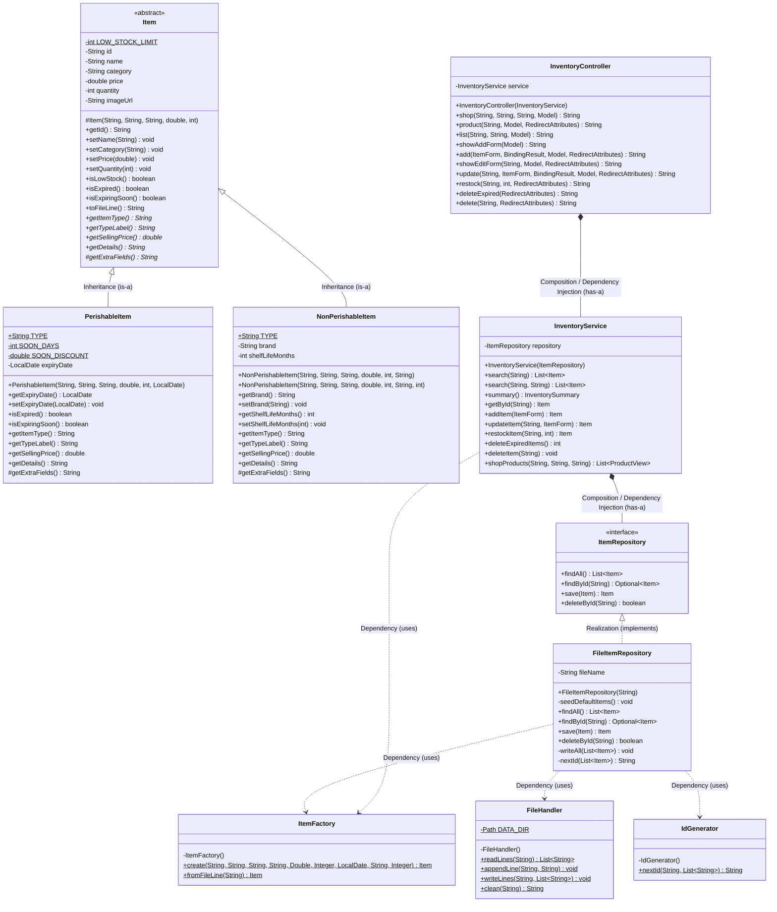

# Member 2: Grocery Inventory & Customer Storefront Module
**Module:** Grocery Inventory & Items (`com.grocery.inventory` + `com.grocery.common`)  
**Agreed ID Prefix:** `ITM` | **URL Mapping:** `/inventory` & `/shop` | **Storage File:** `data/items.txt`

---

## 1. Class Diagram (Inventory + Common Modules)

---

## 2. Object-Oriented Programming (OOP) Implementation

### A. Encapsulation
- All attributes in `Item` (`id`, `name`, `category`, `price`, `quantity`, `imageUrl`), `PerishableItem` (`expiryDate`), and `NonPerishableItem` (`brand`, `shelfLifeMonths`) are declared `private`.
- Setters are marked `public final` and validate inputs before assigning values (throwing `IllegalArgumentException` if name/category/brand is blank, if price/quantity/shelfLifeMonths is negative, or if `expiryDate` is null).
- Information hiding is applied in `Item.isLowStock()` which checks `quantity <= LOW_STOCK_LIMIT` without exposing the private constant `LOW_STOCK_LIMIT = 10`.

### B. Inheritance
- `Item` is the abstract parent class holding common fields and shared methods (`isLowStock()`, `toFileLine()`, `clean()`).
- `PerishableItem extends Item` uses `super(id, name, category, price, quantity)` and adds `expiryDate`, `SOON_DAYS = 3`, and `SOON_DISCOUNT = 0.20`.
- `NonPerishableItem extends Item` uses `super(id, name, category, price, quantity)` and adds `brand` and `shelfLifeMonths`.

### C. Polymorphism
1. **Runtime Polymorphism (Method Overriding):**
   - `getSellingPrice()`: `PerishableItem` gives a **20% discount** (`price * 0.80`) when expiring within 3 days (`isExpiringSoon() == true`); `NonPerishableItem` always returns the regular `getPrice()`.
   - `getDetails()`: `PerishableItem` returns expiry status (`"EXPIRED on ..."`, `"Expires soon: ... (20% off)"`, or `"Expires on ..."`), whereas `NonPerishableItem` returns brand and shelf life (`"Brand: X, shelf life: Y months"` or `"Brand: X (No expiry)"`).
   - `isExpired()` / `isExpiringSoon()`: Default to `false` in `Item`, overridden with `LocalDate` calculations in `PerishableItem`.
   - `getExtraFields()`: Template method hook called inside `Item.toFileLine()` so each child formats its own extra columns.
2. **Compile-Time Polymorphism (Method Overloading):**
   - `InventoryService.search(String keyword)` vs `InventoryService.search(String keyword, String filter)`.
   - `NonPerishableItem` constructor overloading (6 parameters vs 7 parameters using `this(...)` chaining).

### D. Abstraction
- Abstract class `Item` cannot be instantiated directly (`new Item()` is a compile error) and declares 5 abstract methods (`getItemType`, `getTypeLabel`, `getSellingPrice`, `getDetails`, `getExtraFields`).
- Interface `ItemRepository` defines *what* data operations exist (`findAll`, `findById`, `save`, `deleteById`), hiding *how* `FileItemRepository` stores data in `data/items.txt`.
