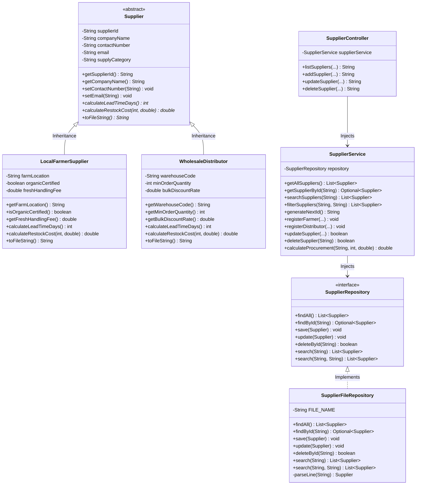

# Member 3: Supplier & Vendor Logistics Management
**Author:** Thilanjana01 (thilanjanadamsara@gmail.com)  
**Module:** Supplier & Vendor Logistics  
**Agreed ID Prefix:** `SUP` | **URL Mapping:** `/suppliers` | **Storage File:** `data/suppliers.txt`

---

## 1. Class Diagram

---

## 2. Object-Oriented Programming (OOP) Implementation

### A. Encapsulation
- All fields in `Supplier`, `LocalFarmerSupplier`, and `WholesaleDistributor` are declared `private`.
- Access is strictly mediated via validated public getters and setters.
- Validations enforce non-blank strings, 9–15 digit phone regex patterns, valid email formatting, positive integer minimum orders, and discount ranges between 0.0 and 0.50 (0%–50%).

### B. Inheritance
- `Supplier` serves as the abstract superclass providing common attributes (`supplierId`, `companyName`, `contactNumber`, `email`, `supplyCategory`).
- `LocalFarmerSupplier` extends `Supplier` with agricultural properties: `farmLocation`, `organicCertified`, `freshHandlingFee`.
- `WholesaleDistributor` extends `Supplier` with industrial freight properties: `warehouseCode`, `minOrderQuantity`, `bulkDiscountRate`.

### C. Polymorphism
1. **Dynamic Method Overriding (Runtime Polymorphism):**
   - `calculateLeadTimeDays()`:
     - Local farmer delivers in 1 day (organic certified) or 2 days (standard fresh produce).
     - Wholesale distributor requires 5 business days for warehouse freight transit.
   - `calculateRestockCost(int units, double unitPrice)`:
     - Local farmer adds cold-chain preservation handling fee: `(units * unitPrice) + freshHandlingFee`.
     - Wholesale distributor applies bulk discount rate when units ordered meet or exceed `minOrderQuantity`: `(units * unitPrice) * (1 - bulkDiscountRate)`.
   - `toFileString()`: Each subclass formats its attributes into a pipe-delimited string tailored for text storage.
2. **Method Overloading (Compile-Time Polymorphism):**
   - `SupplierRepository.search(String keyword)` vs `SupplierRepository.search(String category, String locationOrWarehouse)`.

### D. Abstraction
- The abstract class `Supplier` cannot be directly instantiated, preventing incomplete supplier records.
- The interface `SupplierRepository` separates business contracts from the underlying file I/O operations (`FileHandler`).
